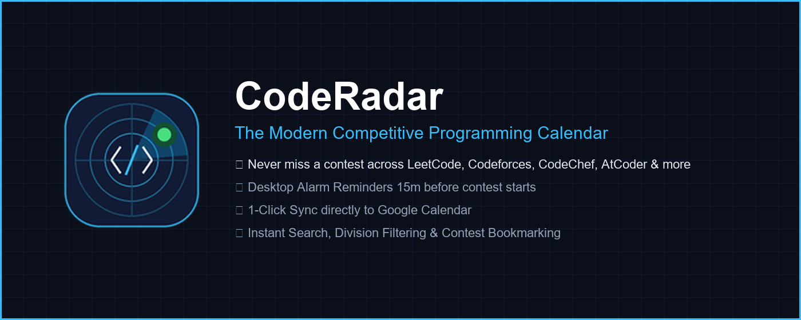

# ⚡ CodeRadar - Coding Contests & CP Calendar

> **Never miss a coding contest again!** A modern, lightning-fast Manifest V3 Chrome Extension that tracks live and upcoming competitive programming contests with desktop alerts and 1-click Google Calendar sync.



---

## 🌟 Why CodeRadar?

CodeRadar is a complete rewrite and modern evolution of legacy CP calendars:
- **⚡ Zero Bloat:** Removed 86KB jQuery and Bootstrap JS; built with pure vanilla ES6+ (< 15ms render time).
- **🔴 Live Countdowns:** Displays real-time status badges (`🔴 LIVE NOW`, `🟡 STARTS IN 2H`, `🟢 UPCOMING`) with dynamic time remaining.
- **📅 1-Click Google Calendar:** Generates instant pre-filled Google Calendar event links with start/end times and contest URLs.
- **🔔 Desktop Reminders:** Built-in Manifest V3 background service worker schedules local desktop alerts 15 minutes before contests start.
- **🔍 Instant Division Search:** Search rounds by name, division, or tier in real-time (`Div. 2`, `Starters`, `Biweekly`, `Rated`).
- **⭐ Star & Bookmarks:** Save your target contests to a dedicated Starred tab.
- **⏱️ Duration Filter:** Automatically filters out multi-week hackathons to focus on standard timed rounds.
- **🛡️ 100% Privacy-First:** No accounts, no user tracking, no third-party telemetry.

---

## 🎯 Supported Platforms

| Platform | Supported Contests |
| :--- | :--- |
| **Codeforces** | All Div. 1, Div. 2, Div. 3, Div. 4 rounds, Educational, Kotlin Heroes |
| **LeetCode** | Weekly Contests & Biweekly Contests |
| **CodeChef** | Starters, Cook-Off, Lunchtime |
| **AtCoder** | Beginner (ABC), Regular (ARC), Grand (AGC) |
| **GeeksforGeeks** | Weekly Practice Contests & Job-A-Thons |
| **HackerEarth** | Monthly Circuit & Hiring Challenges |
| **TopCoder** | Single Round Matches (SRM) |
| **Coding Ninjas / Code360** | Weekend Contests & DSA Challenges |

---

## 🛠️ Project Structure

```
cp-calendar/
├── manifest.json            # Manifest V3 configuration & permissions
├── background.js            # Background service worker (alarms, sync, notifications)
├── popup.html               # Main extension popup interface
├── popup.css                # Custom modern developer dark theme styling
├── popup.js                 # Frontend application logic & state management
├── logo/                    # Vector SVG logo & high-DPI icons (16, 32, 48, 128)
├── images/                  # High-resolution platform logos
├── store_assets/            # Chrome Web Store submission graphics & screenshots
├── dist/                    # Production store ZIP bundle (code-radar-v1.0.0.zip)
├── package.ps1              # Automated build & packaging script
├── STORE_LISTING.md         # Ready-to-copy store listing text, SEO tags & justifications
├── PRIVACY_POLICY.md        # Chrome Web Store compliant privacy policy
├── privacy_policy.html      # Styled privacy policy page for GitHub Pages
└── DEPLOYMENT_GUIDE.md      # Step-by-step developer guide to publish on Chrome Store
```

---

## 🚀 How to Run Locally

1. Clone or navigate to the directory:
   ```bash
   cd c:\Users\sunit\Desktop\cp-calender
   ```
2. Open **Google Chrome** and navigate to:
   ```
   chrome://extensions
   ```
3. Enable **Developer mode** in the top-right corner.
4. Click **Load unpacked** and select the folder `C:\Users\sunit\Desktop\cp-calender`.
5. Pin CodeRadar to your toolbar and click to open!

---

## 📦 How to Package for Chrome Web Store

Run the included PowerShell packaging script:
```powershell
.\package.ps1
```
This outputs a clean production bundle at `dist/code-radar-v1.0.0.zip`.

Follow [DEPLOYMENT_GUIDE.md](DEPLOYMENT_GUIDE.md) for full submission instructions.

---

## 📄 License & Attribution

- Built with data from [CLIST API](https://clist.by) and [Codeforces API](https://codeforces.com/apiHelp).
- Licensed under the MIT License.
